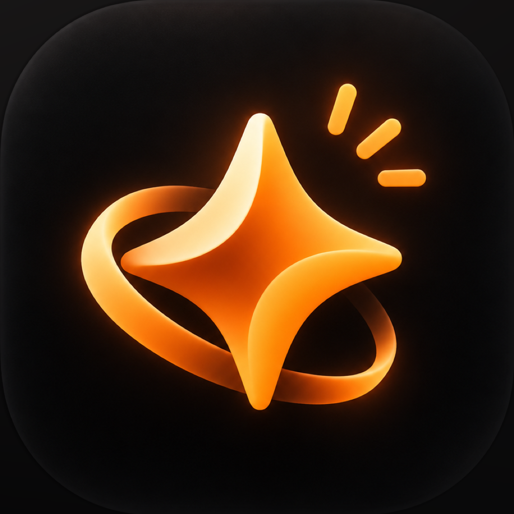

<p align="center">
  
</p>

<h1 align="center">Lockin</h1>

<p align="center">
  Put the phone down. Lock in — alone or with friends.<br>
  An iOS focus app that blocks distracting apps, keeps your daily routines, and lets your friends cheer you on.
</p>

---

## What is Lockin?

Lockin helps you do the things that matter to you, without your phone getting in the way. It is for everyone:
students, people who pray, people who train, people who just want to read for an hour. Nothing in it is tied to
one faith, or any faith.

The app has three tabs.

### 🗓 Today — your daily routines
- Add anything you want to do: a habit, studying, working out, reading, prayer.
- Give it a name and a short detail, like **Water · 2 L** or **Study · 2 hours**, and choose how often:
  every day, certain days, or a number of times a week.
- Prayer is optional. If you add it, Lockin uses your location to show the **real prayer times** for where you are.
- Reminders, streaks, a calendar of what you finished this week, and home screen and lock screen widgets.

### 🔒 Lock in — the main one
- Pick the apps you want to block and tap **Lock in**.
- **Free time** (the default): no timer to choose. You lock in, study as long as you like, and tap **Stop** when you
  are done. The time you really spent is recorded.
- Or choose a set time (25, 50 or 90 minutes).
- Lock in **with a group**. Friends get a notification and can join with one tap.
- A custom shield appears if you try to open a blocked app. A Live Activity and widgets show your timer on the lock
  screen and Dynamic Island.

### 👥 Friends — you are not doing it alone
- Add friends with an invite code, or just hold your phones close together (**Add nearby**).
- Friend requests and group invites that have to be accepted.
- See who is **locked in right now**, a weekly leaderboard and streaks.
- **Cheer** a friend who is locked in (🔥 💪 👏 🙏 ❤️). They get a notification and see your cheer on their countdown.
- **Moments**: share a private photo with your friends (study desk, gym, a good book). Photos are visible only to your
  friends and disappear after 7 days.

## How it works

| Piece | What it uses |
|---|---|
| Blocking apps | Apple's Screen Time APIs: `FamilyControls`, `ManagedSettings`, `DeviceActivity`. Blocking keeps working even if you close Lockin. |
| Screens | SwiftUI, iOS 16.1 and up (interactive widget buttons need iOS 17) |
| Widgets, Live Activity | WidgetKit, ActivityKit, App Intents |
| Friends, groups, cheers, Moments | [Supabase](https://supabase.com): anonymous sign-in, Postgres with row-level security, private storage |
| Notifications | Apple Push Notifications, sent by a Supabase Edge Function |
| Add nearby | MultipeerConnectivity and NearbyInteraction |
| Prayer times | [Adhan](https://github.com/batoulapps/adhan-swift) |

Your data stays small and private: friends only see your name, whether you are locked in, your weekly minutes and
your streak. There are no ads and no tracking.

## Project layout

```
FocusTogether/                 the app (Views, Stores, Managers, Models, DesignSystem)
LockinWidget/                  home and lock screen widgets, Live Activity
DeviceActivityMonitorExtension/  lifts the block when a session ends, even if the app is closed
ShieldConfigurationExtension/  the screen shown over a blocked app
Common/ and Shared/            code shared between the app and its extensions
Backend/                       Supabase SQL migrations and the push notification function
Config/                        signing and Supabase settings
docs/DEVELOPMENT.md            Screen Time setup and device testing notes
Tools/                         app icon sources
```

The Xcode project and its targets are still named `FocusTogether`, the working name of the project. The app is called Lockin.

## Run it yourself

You need a Mac with Xcode 16 or newer, an iPhone, and a paid Apple Developer account. The Screen Time APIs do not
work in the Simulator or with a free account.

1. Copy `Config/Signing.xcconfig` to `Config/Signing.local.xcconfig` (it is git-ignored) and set your own
   `BUNDLE_ID_PREFIX` and `DEVELOPMENT_TEAM`.
2. Open `FocusTogether.xcodeproj`, check **Signing & Capabilities** on all three targets, and run on your iPhone.
   More detail is in [docs/DEVELOPMENT.md](docs/DEVELOPMENT.md).
3. **Optional, for friends:** create a free Supabase project, run the files in `Backend/` in order in the SQL editor
   (`schema.sql`, then `002` to `006`), deploy `Backend/functions/notify`, and put your project host and anon key in
   `Signing.local.xcconfig`. Without this, the app runs with sample friends on the device.
   Push notifications also need an Apple Push key; the setup is explained at the top of
   `Backend/functions/notify/index.ts`.

> The Screen Time **Family Controls (Distribution)** permission from Apple is needed before the app can be put on
> TestFlight or the App Store. Development builds work without it.

## Status

Lockin is in active development and being tested by a small group of friends. Next: TestFlight and a public release.

## License

All rights reserved for now. If you would like to use any part of this, please open an issue.
